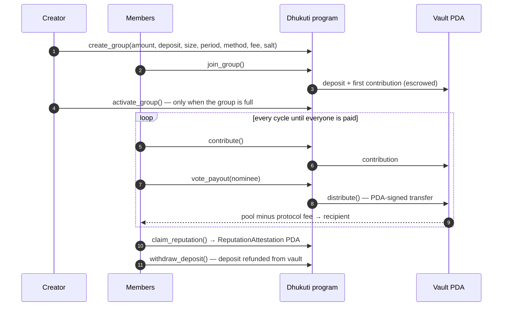

# Dhukuti Protocol

**Trustless rotating savings circles (ROSCAs) on Solana.** An Anchor program holds every contribution and security deposit in a PDA vault, so no organizer ever has custody of the pool. Members vote on who gets paid each cycle, a security deposit backs every seat, and everyone who finishes the circle gets an on-chain reputation attestation they can carry as credit history.

[**Live dApp**](https://dhukuti-protocol.vercel.app) · [**Docs**](https://docs-dhukuti-protocol.vercel.app) · [**Program on Solana Explorer (devnet)**](https://explorer.solana.com/address/egyrA1EJRsr2b7QbciVXX78U3TkPy8GQ9dTDJQHPHvo?cluster=devnet)


| | |
|---|---|
| **Program ID (devnet)** | `egyrA1EJRsr2b7QbciVXX78U3TkPy8GQ9dTDJQHPHvo` |
| **On-chain** | Rust · Anchor 0.31.1 · 9 instructions · 4 account types · PDA-signed SOL escrow |
| **Client** | Next.js 15 · React 19 · `@coral-xyz/anchor` · Solana Wallet Adapter (Phantom, Solflare) |
| **SDK** | TypeScript PDA helpers in [`sdk/`](sdk/src/index.ts) |
| **Tests** | Full ROSCA lifecycle against a local validator ([`tests/dhukuti.ts`](tests/dhukuti.ts)) |

---

## Why

Rotating savings groups — *Dhukuti* in Nepal, *Chit Fund* in India, *Susu* in West Africa, *Arisan* in Indonesia, *Paluwagan* in the Philippines — are how millions of underbanked people save. A group contributes a fixed amount every cycle and one member takes the whole pool, until everyone has had a turn.

They run on trust, and that trust breaks in predictable ways:

- **Organizer risk** – whoever holds the cash can disappear with it.
- **Default after payout** – a member who gets paid early can stop contributing.
- **Opaque records** – who paid, who's next, and disputes all live in someone's notebook.
- **No credit history** – years of reliable saving leave no formal record.

Dhukuti Protocol moves the rules into a program: funds sit in a vault only the program can sign for, every contribution and payout is on-chain, and completing a circle produces a verifiable reputation record.

<details>
<summary><b>Explain it like I'm five</b></summary>

Imagine you and 4 friends save together. Every week everyone puts in some coins, and one friend takes all the coins home. Next week a different friend takes them, until everyone has had a turn.

Normally one person has to hold all the coins — but what if they run away? Dhukuti Protocol is a piggy bank on a computer that holds the coins for you. Nobody can take them unless the rules say so, and the computer checks the rules by itself.

</details>

## How it works



### Instructions

| Instruction | Who | What it enforces |
|---|---|---|
| `create_group` | creator | 2–32 members, protocol fee ≤ 1% (100 bps), salt lets one creator run many groups |
| `join_group` | member | group is `Forming` and not full; escrows security deposit + first contribution |
| `activate_group` | creator only (`has_one`) | group must be full; starts the cycle clock |
| `contribute` | member | group `Active`, member active, one contribution per cycle |
| `vote_payout` | member | vote-allocation groups only, no self-votes, one `VoteRecord` PDA per voter per cycle |
| `distribute` | anyone | pool complete, recipient not yet paid, recipient has votes; pays pool − fee via PDA signer, advances the cycle, marks `Completed` after the last one |
| `claim_reputation` | member | group `Completed`, once per member; mints a `ReputationAttestation` (score = cycles × 100) |
| `withdraw_deposit` | member | group `Completed`, deposit refunded exactly once |
| `slash_deposit` | anyone | *In progress:* after cycle period + 24h grace, a member who didn't contribute loses their deposit. The lamport move is being switched to a PDA-signed CPI (see Roadmap) |

### Accounts (PDAs)

| Account | Seeds |
|---|---|
| `DhukutiGroup` | `["group", creator, salt_le_u64]` |
| Vault (lamports only) | `["vault", group]` |
| `Member` | `["member", group, wallet]` |
| `VoteRecord` | `["vote", group, cycle_u8, voter]` |
| `ReputationAttestation` | `["reputation", group, wallet]` |

Arithmetic on balances uses checked math, and the release profile keeps `overflow-checks = true`.

## Repository layout

```
programs/dhukuti/   Anchor program (Rust) — lib.rs, state.rs, errors.rs, instructions/
tests/              TypeScript lifecycle tests (mocha + chai)
app/                Next.js dApp — wallet adapter, group dashboard, voting, reputation
sdk/                PDA derivation helpers
docs/               Documentation site (Bun + React)
.github/workflows/  Manual devnet deploy (anchor build + anchor deploy)
```

## Run it locally

**Prerequisites:** Rust, [Solana CLI](https://solana.com/docs/intro/installation), [Anchor 0.31.1](https://www.anchor-lang.com/docs/installation) (`avm install 0.31.1`), Node 20+.

```bash
git clone https://github.com/aadityakumarsah/Dhukuti-Protocol.git
cd Dhukuti-Protocol
npm install

npm run build:program        # cargo build-sbf -> target/deploy/dhukuti.so
npm run validator            # terminal 1: local validator with the program at its devnet address
npm run test:local           # terminal 2: full lifecycle suite
```

> If the SBF build fails with `feature 'edition2024' is required`, your platform-tools toolchain is older than some transitive crates. Run `cargo update -p blake3 --precise 1.5.5` and build again.

**Frontend**

```bash
cd app
cp .env.example .env.local     # points at devnet + the deployed program
npm install
npm run dev                    # http://localhost:3000
```

Switch your wallet (Phantom / Solflare) to **devnet** and grab test SOL from [faucet.solana.com](https://faucet.solana.com).

## Tests

`tests/dhukuti.ts` drives a 3-member, vote-allocated group through its whole life on a local validator:

```
dhukuti
  ✔ creates a group in Forming state
  ✔ rejects a protocol fee above 1%
  ✔ escrows deposit + first contribution in the PDA vault when members join
  ✔ only lets the creator activate a full group
  ✔ blocks double contributions and self-votes
  ✔ cycle 0: only a voted member can be paid, payout = pool minus fee
  ✔ cycle 1: refuses to distribute an incomplete pool or pay someone twice
  ✔ cycle 2: final payout completes the group
  ✔ issues an on-chain reputation attestation once per member
  ✔ refunds security deposits after completion, exactly once

10 passing
```

Each test checks real lamport balances — the vault, the recipient's payout (pool − fee), and the fees left in escrow at the end.

## Roadmap

This is an MVP on devnet. Next steps before anything touches real money:

- [ ] SPL-token / USDC pools alongside native SOL
- [ ] Route `slash_deposit` through a PDA-signed system transfer and pay slashed deposits to the remaining members
- [ ] Restrict `distribute` to members and pick the top-voted nominee on-chain; verifiable randomness (VRF) for random draws
- [ ] Validate `cycle_period > 0` and add keeper-driven cycle deadlines
- [ ] Send protocol fees to a treasury PDA
- [ ] Zero-knowledge reputation proofs (the app currently ships a placeholder in `app/src/utils/zk-proof.ts`)
- [ ] Independent audit before mainnet

See [SECURITY.md](SECURITY.md) to report a vulnerability.

---

Built by [Aaditya Kumar Sah](https://aadityakumarsah.pages.dev) · [GitHub](https://github.com/aadityakumarsah) · [X](https://x.com/aadityakumarsa)
